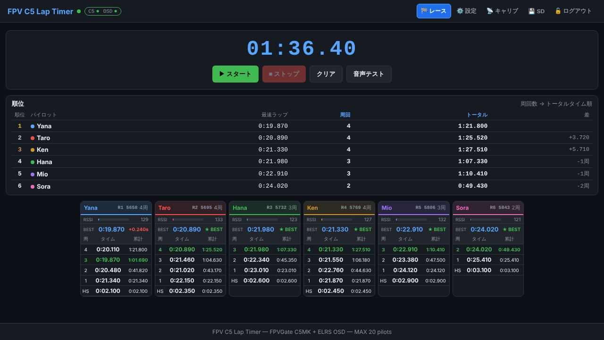
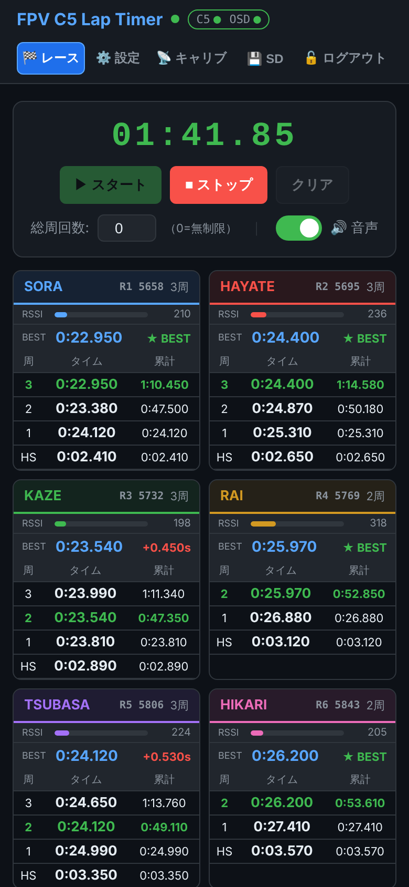
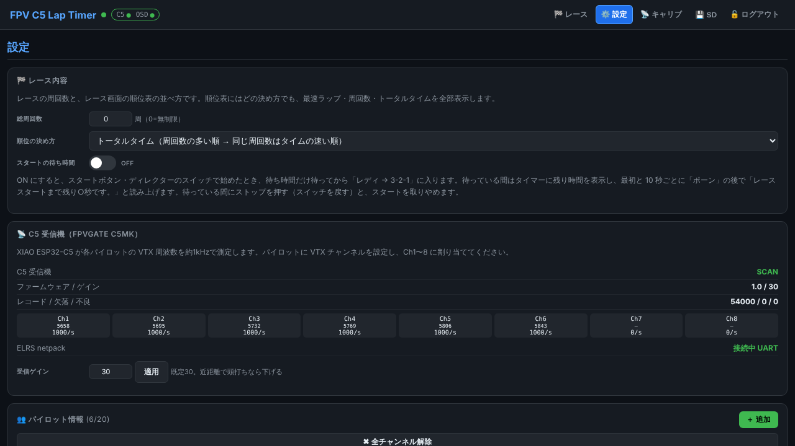
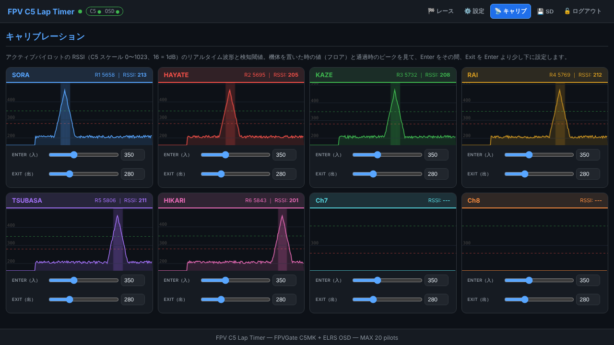
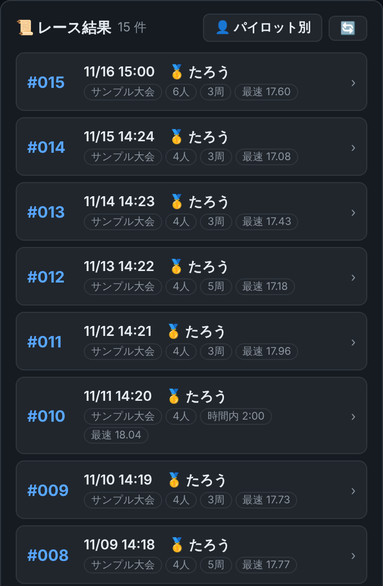
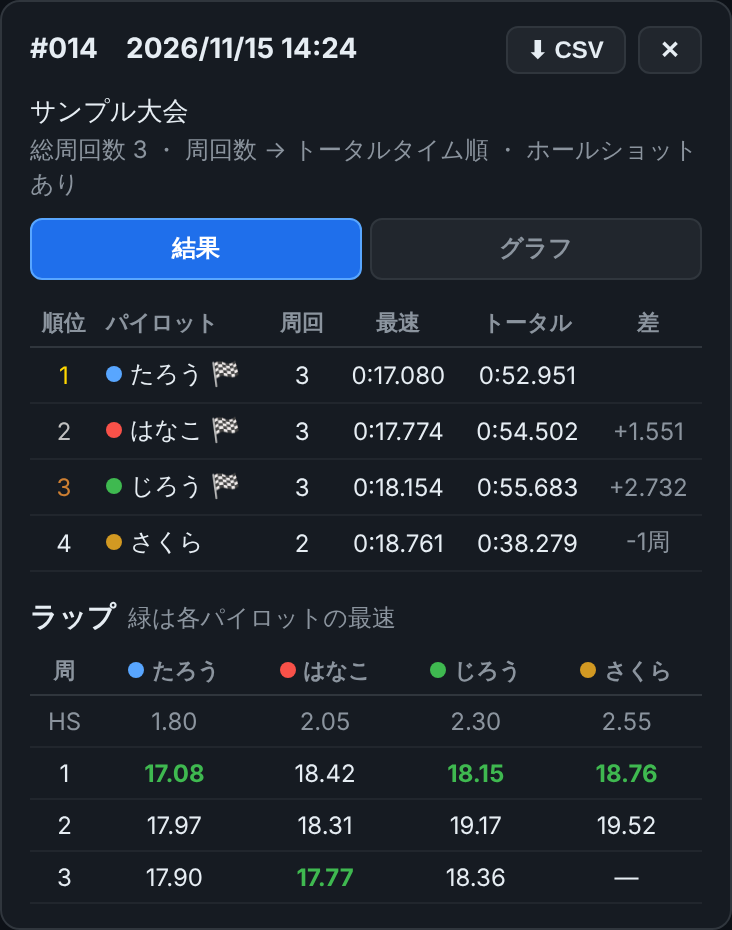
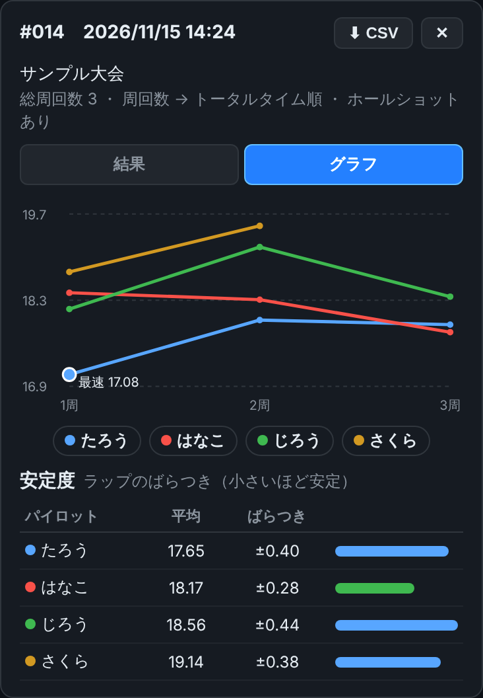
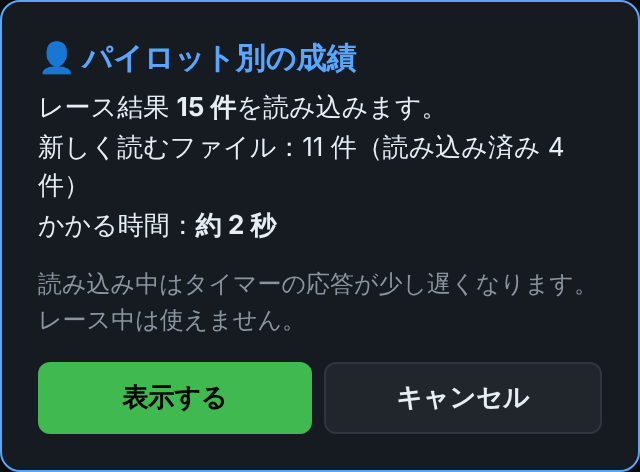
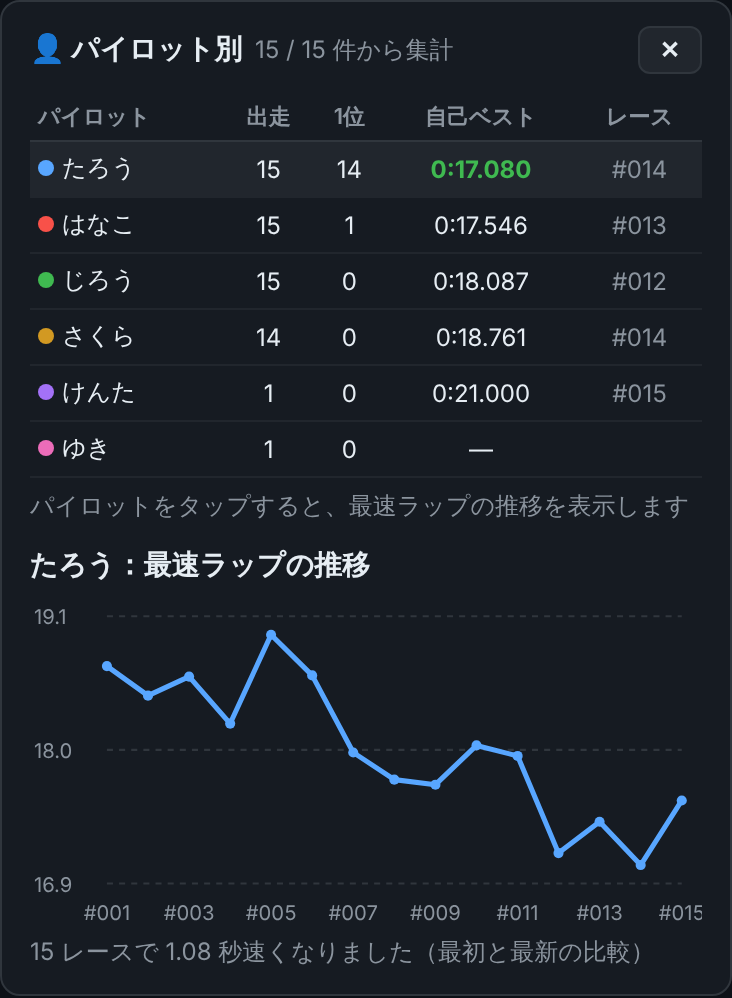

# FPV C5 Lap Timer

🌐 [日本語](README.md) | **English**

### Up to 8 quads timed at once

- **One receiver times up to 8 quads at the same time** (8 channels; each quad is told apart by its VTX frequency).
- Nothing goes on the quads, so **8 pilots can race with the quads they already fly**: no transponders or beacons to fit.
- **Register up to 20 pilots** and assign 8 of them to the channels for each race.
- Laps and positions for all 8 show live **in the web UI, in voice announcements and on each pilot's HDZero goggles (OSD)**.

An FPV drone lap timer. No transponder on the
quad: a **XIAO ESP32-C5 running [FPVGate C5MK](https://github.com/yanazoo/FPVGateC5MK)**
measures each pilot's own 5.8 GHz VTX at ~1 kHz, a **XIAO ESP32-S3** detects
gate passes at the RSSI peak, and lap times go to the pilots' **HDZero**
goggles through the ESP-NOW bridge of
**[elrs-netpack](https://github.com/yanazoo/elrs-netpack)** and the goggles'
ELRS backpack, using a firmware port of
**[vrxc_elrs](https://github.com/yanazoo/vrxc_elrs)**'s OSD logic.

> [!IMPORTANT]
> **The goggle OSD works with HDZero goggles (with an ELRS backpack) only.**
> Other goggles show no OSD; lap timing, the web UI and voice announcements
> still work.

> [!TIP]
> **Sister project: [ESP-NOW Lap Timer](https://github.com/yanazoo/ESP-NOW-Lap-Timer)**,
> which times a small beacon (XIAO ESP32-C3/C6) carried on each quad. See
> [Sister project](#sister-project-esp-now-lap-timer) for the differences.

```
VTX 5.8 GHz ─▶ XIAO ESP32-C5 (C5MK) ─UART 921600─▶ XIAO ESP32-S3 (this firmware)
                                                    gate detection, laps, Web UI, SD,
                                                    ELRS OSD (vrxc_elrs port)
                                                        │ MSP v2: A. UART 115200 direct (recommended),
                                                        │ or B. WiFi TCP 8080 via the netpack XIAO
                                                        ▼
               ESP-NOW bridge (XIAO ESP32-C3 or ESP32 Wrover-E) ─ESP-NOW ch1─▶ HDZero goggles
```

## Screenshots (web UI)

The web UI in a phone or PC browser, shown here with sample pilots and laps.

**Race (PC)**: from the top, the race clock with Start / Stop / Clear /
voice test, the **ranking table**, and one card per assigned channel (8 per
row on a PC, 4 on a phone in landscape, 2 in portrait). The ranking table
lists every pilot's best lap, laps and total time, ordered by the ranking
rule in Settings. Each card shows RSSI, best lap, lap times and totals. The
header lamps show the C5 receiver and OSD links (green: connected, red: not
connected).



| Race (phone, portrait) | Settings (🏁 race content, C5 receiver, pilots) |
|---|---|
|  |  |

**Calibration**: each pilot's RSSI trace with the Enter (green dashed) and
Exit (red dashed) thresholds. Set them so a gate pass rises above Enter and
falls back below Exit.



**🎤 Microphone (optional)**: the microphone on the XIAO ESP32-S3 **Sense**
board (no wiring). It only works, and only shows, when the microphone is
found (nothing appears without the Sense board). At the bottom of the
Calibration tab, a loudness graph
(0–100) with the thresholds as dashed lines, set like a pilot's.

- **Start by sound** (マイクでスタート): with no race on (after Clear), sounds
  above the green line, each lasting at least the start detection time, the
  **set number of times** (閾値越えカウント回数, 1–9, default 2; at most 0.8 s
  between them) start the race like the Start button (start delay → ready →
  3-2-1). Only an exact count does, so 2 or more rarely starts by mistake.
  Not within 5 s of a stop or clear. For example two claps = 2 times,
  0.02 s; one whistle or air horn = 1 time, 0.2 s.
  With **即スタート** (start now) on, the signal itself is GO: no start
  delay, no ready, no 3-2-1; the clock runs from when the last sound began,
  as soon as the count is reached.
- **Three to clear** (閾値越え 3 回でクリア): after a stop, three such sounds
  clear the race like the Clear button (saved to SD the same way).
- **False start** (フライング検知): a sound above the red line (a quad
  throttling up) lasting its own set time between ARM NOW and GO **stops the race, announces
  "フライングです。レースを中止します。" and clears the count**; the goggles
  show FALSE START.
- Keep the thresholds above the 3-2-1 tones and the phones' announcements.
  The level is relative to the microphone's maximum (not a sound-level meter's
  dB), so set it on site. All of them are off by default, and are part of the
  settings backup.

### 💾 SD card: look back at past races

Every race is saved on the SD card when you press Clear (the file name holds
the race's date and time), and the **SD tab** shows them any time. The files
also open in Excel.

- **📜 Race results**: newest first, with date, winner, event, pilots, laps
  and best lap.
- **Results** (結果): the ranking and lap table of one race; each pilot's best
  lap in green.
- **Graph** (グラフ): lap times lap by lap, and consistency (mean and spread);
  tap the legend to show or hide a pilot.

| Race list | Results | Graph |
|---|---|---|
|  |  |  |

- **👤 Per pilot** (パイロット別): totals over every saved race (races, wins,
  personal best, and the best-lap trend). It reads every file, so it first
  shows how many and **about how long that takes**.

| Before reading | Per-pilot stats and trend |
|---|---|
|  |  |

## Wiring

| XIAO ESP32-S3 | | XIAO ESP32-C5 |
|---|---|---|
| D3 / GPIO4 (TX) | → | D4 / GPIO23 (RX) |
| D4 / GPIO5 (RX) | ← | D5 / GPIO24 (TX) |
| 5V | — | 5V (**power the C5 from 5 V**, not the S3's 3V3) |
| GND | — | GND |

- microSD: XIAO ESP32-S3 Sense slot (CS 21, SCK 7, MISO 8, MOSI 9).
  - **Races**: each race is saved on Clear as `race_NNN_YYYYMMDD_HHMM.csv`
    (number, start date and time; `race_NNN.csv` when the timer has no date
    yet). Numbers go 000–999 and start again; rotate mode keeps the last 20
    races and deletes the one with the oldest date in its name. The browser's
    clock is passed to the timer, so each file starts with a `#FPVC5,...` line
    holding the race's start time and rules.
  - **SD tab**: the races, newest first; one race as results and a lap-time
    graph; per-pilot stats across all races (after an estimate of how long
    reading them takes); formatting the card (under "⚠ その他の操作": deletes
    every file, the admin password is asked again).
  - **Backups** (Settings → 💾 SDカード): **pilots** (`pilots_YYYYMMDD_HHMM.csv`)
    and **every other setting** (`settings_YYYYMMDD_HHMM.json`: race content,
    detection, ELRS OSD, microphone, WiFi, fixed IP, connection limits, login hold, admin
    password), each with Save and Restore. Restore lists the saved files,
    newest first, to pick from. Settings can't be restored during a race, and
    restored WiFi settings take effect after a restart.
  - **Connection QR image** (same box): the connection QR codes as one PNG to
    print (`qr_host_YYYYMMDD_HHMM.png` / `qr_client_YYYYMMDD_HHMM.png`).
  - Settings backups and QR images hold the WiFi password, so only a
    logged-in admin can download them.
- Goggle OSD, option A (recommended, the base setup): the ESP-NOW bridge
  (`elrs-espnow-bridge` on a XIAO ESP32-C3 or ESP32 Wrover-E) is wired
  straight to the S3 over UART; no netpack XIAO and no WiFi setup — see
  [docs/ELRS_UART_SETUP.md](docs/ELRS_UART_SETUP.md) (Japanese). Connect GND only, not the power pins.

  | XIAO ESP32-S3 | | XIAO ESP32-C3 (`xiao_esp32c3`) | ESP32 Wrover-E (`esp32dev`) |
  |---|---|---|---|
  | D6 / GPIO43 (TX) | → | D7 / GPIO20 (RX) | GPIO26 (RX) |
  | D7 / GPIO44 (RX) | ← | D6 / GPIO21 (TX) | GPIO27 (TX) |
  | GND | — | GND | GND |

- Option B (the next choice, WiFi): the full elrs-netpack (netpack XIAO +
  ESP-NOW bridge); the netpack XIAO joins the same WiFi as the timer (its AP
  in host mode, or the same router in client mode) and the timer finds it on
  port 8080 automatically (`auto` scans AP clients, or looks up
  `elrs-netpack.local` in client mode). A bridge wired to the UART may stay
  connected: while WiFi is selected the timer parks it so it doesn't get in
  the netpack's way.

## Build and flash

```bash
git clone --recurse-submodules https://github.com/yanazoo/FPV-C5-Lap-Timer.git
cd FPV-C5-Lap-Timer
# C5 receiver (FPVGate C5MK, from the submodule)
pio run -d third_party/FPVGateC5MK/multipilot -e xiaoc5 -t upload
# S3 timer + web UI
pio run -e xiao_esp32s3 -t upload
pio run -e xiao_esp32s3 -t uploadfs
# ESP-NOW bridge (xiao_esp32c3 or esp32dev)
pio run -d third_party/elrs-netpack/elrs-espnow-bridge -e xiao_esp32c3 -t upload
```

Add `--upload-port COMx` if the wrong port is picked; if the port is not
found, hold BOOT while pressing RESET and retry. Prebuilt binaries are in the
CI artifacts `fpv_c5-xiao_esp32s3`, `fpvgate_c5mk-xiaoc5` and
`elrs-espnow-bridge`.

Defaults on first boot:

| Setting | Default |
|---|---|
| WiFi (host mode) SSID | `FPV-C5-LT` |
| WiFi (host mode) password | `fpv-c5-lt` |
| Web UI | `http://20.0.0.1` (client mode: `http://fpv-c5-lt.local`) |
| Admin password (login) | `admin` |
| netpack XIAO setup AP (WiFi link only) | SSID `ELRS-Netpack-Setup`, password `elrs-netpack`, `http://192.168.4.1` |

Then join WiFi `FPV-C5-LT` (password `fpv-c5-lt`), open `http://20.0.0.1`,
log in (`admin`), **change the WiFi (host AP) and admin passwords** in
Settings (the defaults are public), add pilots with their VTX channel and ELRS bind phrase, assign them
to Ch1–8, enable ELRS OSD (connection: UART for the direct bridge, WiFi for
the netpack XIAO) and calibrate Enter/Exit in the Calib tab
(C5 scale 0..1023, 16 counts per dB). The race tab shows only the assigned
channels.

**🏁 レース内容** (race content, top of the Settings tab): total laps (0 =
no limit) and the ranking rule: total time (most laps, then fastest), best
lap, or **laps within a time limit** (30 s to 30 min; choose whether the last
lap after time-up counts). **Start delay** (スタートの待ち時間): an ON/OFF switch (off by
default) and 10, 15, 30, 60 s or any 1–600 s. With it on, a start from the button or the director's switch
waits this long before "ready → 3-2-1"; the timer shows the time left in
orange, and at the start and every 10 s a chime is followed by the call-out
"レーススタートまで残り○秒です。" (with voice on). Stop (or switching back)
during the wait cancels the start.

**Race director's switch** (optional): in 🥽 ELRS OSD, enter the race
director's bind phrase ("ディレクターバインドフレーズ") and pick the switch
kind: **toggle** (a switch that stays put: on starts, off stops) or **push**
(a button: each press starts or stops; presses within 1.5 s count once). On
the TX, assign the switch to Lua → Backpack → **DVR Rec**.

## Racing

- **Start** (or the race director's switch): after the start delay, if it is
  on, "レディ" is said, then a 3 s
  countdown (**ARM NOW** and 3, 2, 1 on the goggles), then **GO!**. The timer
  runs this sequence, so every open browser and every goggle follow it at the
  same moment.
- Each gate pass records a lap: tones, Japanese TTS, the OSD, and the ranking
  table update at once.
- **Stop** pauses (**LAND NOW!**); the clock stays on the stopped time on the
  timer and the goggles. **Start** again resumes (the pause is left out of
  the laps).
- **Laps within a time limit**: the timer and the goggles count the time left;
  "残り30秒" / "残り20秒", then every second from 10, and a fanfare at 0 (ticks
  with voice off). After time-up the clock shows the time over in red (minus)
  until Stop.
- **Deleting a wrong lap** (a shortcut): logged in, tap the lap's row on a race
  card and confirm. The pass is taken out and its time joins the next lap (the
  total stays); the last lap is just dropped, and deleting the holeshot makes
  the next pass the holeshot. Every browser, the ranking, the goggles and the
  SD record follow.
- **Clear** saves the race to SD as CSV and clears every browser and goggle.
- "音声テスト" plays the gate tone and a sample call (voice settings are in
  the Settings tab). Tap the page once after opening it so the browser may
  play sound.
- PC and phone browsers show the same race time: it runs on the timer's
  clock, every button reaches every browser, and a browser that missed a
  message catches up within a second.

After `git pull`, run `git submodule update --init --recursive` and flash the
S3 (`upload` and `uploadfs`) and, for the UART link, the ESP-NOW bridge again.

### Goggle OSD

Rows are written at their full width. The OSD "clear" command is only sent
at ARM NOW and when laps are cleared, so a packet lost on the ESP-NOW hop
leaves the previous text up instead of blanking the row. The lap time stays
up for 5 s after the pass. The race clock shows 3, 2, 1 during ARM NOW,
starts at GO! (the time left in a timed race, then `-mm:ss`), and stays on
the stopped time until the laps are cleared. Passes after a pilot completes
the total laps don't count.

To cover lost packets:

- **Changes**: the whole screen goes out, again 0.2 s apart (2 times, 4 for
  something removed), and 4 more times over 1–5.5 s. An emptied row is sent
  as spaces for 8 s.
- **Race clock**: each second only the clock row; the whole screen for a few
  seconds after a change and every 2 s.
- **ESP-NOW bridge**: **connectionless** (broadcast, no ACK wait, no retries),
  each update sent **3 times** at least 3 ms apart. Goggles that are off
  don't delay anyone; two goggles on one bind phrase both show the OSD.
- In client mode, put the router on 2.4 GHz **channel 6–11** (ESP-NOW is
  fixed to channel 1).

### WiFi modes (Settings → 📶 WiFi)

- **Host** (default): the timer is an access point, `http://20.0.0.1`.
- **Client**: the timer joins an existing 2.4 GHz router and is reachable at
  `http://fpv-c5-lt.local` (it redirects to the IP address: Chrome's Local
  Network Access blocks a plain-http page on a .local name from loading its
  scripts). If it cannot connect for the chosen time (15, 30
  or 60 s, default 30 s; "ホストに切替" in the WiFi card), at boot or after
  losing the link, it falls back to host mode, and the WiFi card says why
  (not found, wrong password, security not supported...). While nobody is
  on its access point, it keeps looking for the router and restarts into
  client mode once the router is back (a router that started later than the
  timer); not during a race or with laps not cleared, and not after a wrong
  password. Losing the link during a race (or with laps not cleared), it
  waits for the router for the time set in "レース中に切れたら" (15 s,
  30 s, 1, 3 or 5 min, or as long as it takes; default 1 min) before it
  starts the access point; timing goes on meanwhile. The router password is stored on the device only and never
  sent back to the browser.

## Restart and a fixed IP address

- Settings → "🔄 再起動" → "タイマーを再起動": pulling the plug, remotely, for when something is wrong. The timer (XIAO ESP32-S3) closes the browsers' connections, tells the router (or the phones on its access point) it is leaving, unmounts the SD card, **stops for 2 s** and starts much like a power-on. The C5 receiver and the ESP-NOW bridge keep running and the links come back after the restart; the page reopens by itself (log in again).
- Settings → "🔄 再起動" → "🔁 全員の画面を再読み込み" (admins): every open page (viewers too) reloads; the timer keeps running.
- When the timer has restarted (the button, a power cycle, `uploadfs`), open pages reload themselves on reconnecting.
- Under Settings → "🔄 再起動": the uptime, why the timer last started (power-on, the restart button, a crash...), free memory, and how many starts followed a crash (kept across power cycles).
- "+LAP" on a race card (admins, during a race), next to BEST: records a lap for that pilot now (a pass the receiver missed), like a gate pass; ignored within the cooldown.
- Settings → "📱 接続用 QR コード": scan to open the page. Host mode: join the timer's WiFi, then open the page; client mode: join the router's WiFi, then open the page by IP address (the router password reaches logged-in admins only). "大きく表示" shows them large.
- Settings → WiFi → "IP アドレス" (client mode): DHCP by default, or fixed (address, subnet mask, gateway, optional DNS). Saving restarts the timer.

## Connections and the spectator screen

Browsers are **admins** (logged in) or **viewers**. Limits are in Settings → "👥 接続台数".

- Admins: 1–4 (default 2). A login past the limit is refused with a message; admins are never disconnected. A login is released when no browser has used it for the hold time (15 s, 30 s, 1, 3, 5, 10 or 30 min, default 1 min; "ログインの保持"), or at once on logout; coming back within it keeps the login.
- Viewers: the light spectator screen (race clock, laps, ranking; no RSSI). Host mode 1–8 (default 3; admins + viewers at most 9, so the netpack always has the 10th place on the access point: with 4 admins, 5 viewers), client mode 1–8 (default 6); past the limit the oldest viewer is disconnected (a "再接続" button reconnects).
- The netpack (WiFi) is not counted and never disconnected. In host mode, when the timer's WiFi is full (10 stations) and the netpack is not connected, one station is sent off to make room: a device with no page open first, then a viewer, never an admin. That device is kept out for 30 s (until the netpack is back).
- The timer's date (race file names) comes from logged-in browsers only.
- A viewer closed for being past the limit is told how many viewer places
  there are (e.g. "ホストモード：3 台").

## Layout

- `lib/timer_core/` — platform-independent core: `race_core` (laps,
  holeshot, cooldown, pause, positions, finish), `gate_tracker` (FPVGate's
  pass detection), `osd_engine` (vrxc_elrs port), `msp_v2` (MSP v2 + bind
  phrase UID).
- `src/` — Arduino glue: C5 UART task, web server, SD, NVS, OSD transport.
- `data/` — web UI.
- `third_party/` — FPVGateC5MK, elrs-netpack and vrxc_elrs as pinned submodules.

## Tests

`bash test/run.sh` runs the core unit tests, a simulated C5MK UART →
c5host → gate detection → laps pipeline, and a cross-check that loads the real
vrxc_elrs Python source and compares bind-phrase UIDs and OSD bytes with the
firmware's, byte for byte. The web UI runs against a mock server with no
hardware: `python3 tools/mock_server.py`, then `http://localhost:8000`
(`/mock/seed` loads sample pilots and a race). CI (`.github/workflows/ci.yml`) runs them and
builds the S3 timer, the C5 firmware and the ESP-NOW bridge (Wrover-E and
XIAO ESP32-C3).

## Sister project: ESP-NOW Lap Timer

[ESP-NOW Lap Timer](https://github.com/yanazoo/ESP-NOW-Lap-Timer) is a sister
project by the same author. It times passes differently; the web UI, voice
announcements and SD logging work the same way. Pick the one that suits your
gear.

| | FPV C5 Lap Timer (this repository) | ESP-NOW Lap Timer |
|---|---|---|
| Signal timed | each pilot's **5.8 GHz VTX** (RSSI) | an **ESP-NOW beacon** on the quad (RSSI) |
| On the quad | **nothing** (pilots told apart by VTX frequency) | a XIAO ESP32-C3/C6 beacon |
| Gate receiver | XIAO ESP32-C5 + FPVGate C5MK | ESP32-WROVER-E |
| Pass detection | XIAO ESP32-S3 (peak of the C5's raw RSSI) | the gate node |
| Goggle display | OSD on HDZero goggles (via the ELRS backpack) | none |
| Web UI / voice / SD log | yes | yes |

## Licences

FPVGate C5MK (including `c5host`) is CC BY-NC-SA 4.0 (non-commercial);
vrxc_elrs and elrs-netpack are GPL-3.0; the QR code library
(`data/js/qrcode.js`, qrcode-generator by Kazuhiko Arase) is MIT. The combined firmware is meant for
personal, non-commercial use.
